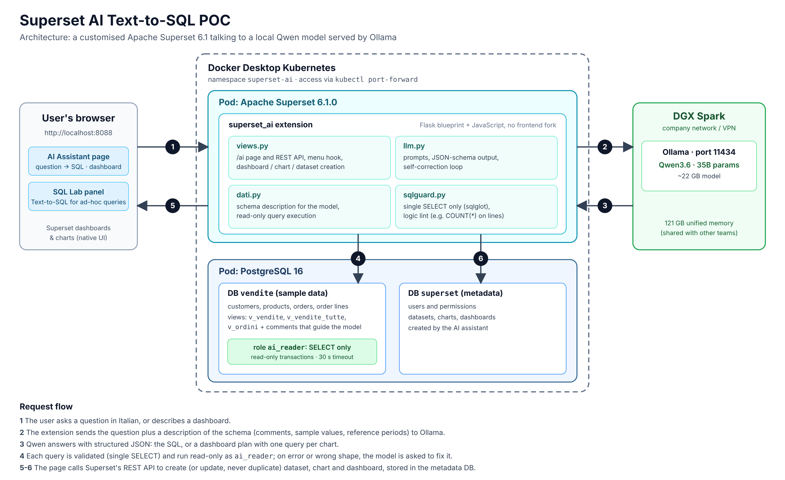

# Superset AI Text-to-SQL (proof of concept)

A customised **Apache Superset 6.1** that turns questions written in natural language into SQL and builds dashboards on the fly, using a **local LLM** (Qwen served by Ollama) instead of an external API.

> **Status: proof of concept.** It is a learning project, built to explore how far a self-hosted model can go on Text-to-SQL and automatic dashboard creation. It runs on synthetic data and is not production-ready.



## What it does

- **AI Assistant page** (`/ai/`): write a question in Italian ("Top 10 products by margin") and get the generated SQL, an explanation and the result table. Describe a dashboard ("Sales overview: KPIs, monthly trend, categories and channels") and Superset creates the dataset, charts and dashboard for you.
- **Text-to-SQL in SQL Lab**: a floating panel that generates a query and either opens it in a new SQL Lab tab or inserts it in the current editor.
- **Dashboards are updated, not duplicated**: asking again for the same dashboard updates the existing one and reuses datasets and charts that already exist. A "clean up" button removes the AI-created charts and datasets that no dashboard uses.
- **Light/dark theme** support on the AI page.

## How it works

1. The extension describes the database schema to the model: tables, views, column comments, typical values, date ranges and pre-computed reference periods ("last month", "last quarter").
2. The model answers with **structured JSON** (an Ollama JSON schema), either a SQL query or a dashboard plan with one query per chart.
3. Every query is checked before it runs: a single `SELECT` only (parsed with `sqlglot`), plus a small logic lint for typical model mistakes (for example `COUNT(*)` on a per-line view, or `GROUP BY` columns that are not returned).
4. Queries run as a **read-only PostgreSQL role** (`ai_reader`: `SELECT` only, read-only transactions, 30 s timeout), so even a bad query cannot change data.
5. If a query fails or returns the wrong shape for the chosen chart, the model is asked to fix it (up to a few attempts); charts that stay invalid are dropped and reported in the log.
6. Charts, datasets and dashboards are created through Superset's **official REST API**, with the permissions of the logged-in user.

Business rules live in the data, not in the prompt: `v_vendite` contains only valid sales (cancelled orders excluded), `v_vendite_tutte` includes cancelled ones, and `v_ordini` has one row per order for counting orders. This proved far more reliable than asking the model to remember filters.

The extension is a Flask blueprint plus a few static JavaScript files loaded through Superset's `FLASK_APP_MUTATOR` hook. There is **no fork of the Superset frontend**.

## Stack

| Layer | Technology |
|---|---|
| BI | Apache Superset 6.1.0 (official image + `superset_ai` extension) |
| Database | PostgreSQL 16 (sample data + Superset metadata) |
| Model | Qwen3.6, 35B parameters (about 22 GB), served by Ollama |
| Model host | NVIDIA DGX Spark (121 GB unified memory) on the company network |
| Runtime | Docker Desktop Kubernetes, PowerShell deploy scripts |

## The language model connection (read this before running)

The project was developed against **one specific machine**: a company DGX Spark running Ollama, reachable from a work PC over VPN. That machine's details are **defaults in the code, not a universal setting, and must be set again for your environment**:

| What | Where it is set | Default |
|---|---|---|
| Ollama address | `deploy.ps1 -OllamaUrl ...` (ConfigMap `superset-ai-config`); fallback in `superset/superset_ai/settings.py` | an internal IP address on port 11434 |
| Model name | `deploy.ps1 -Model ...`; fallback in `settings.py` | `qwen3.6:35b` |
| Timeout, thinking mode, context size | `OLLAMA_TIMEOUT`, `OLLAMA_THINK`, `OLLAMA_NUM_CTX` (see `k8s/20-superset.yaml`) | 240 s, off, server default |

```powershell
# point the pods to your own Ollama server and model
.\scripts\deploy.ps1 -OllamaUrl http://<your-ollama-host>:11434 -Model <your-model> -SkipBuild
# check that the pods can reach it
.\scripts\test-ollama.ps1 -OllamaUrl http://<your-ollama-host>:11434
```

Notes:

- The model must already be pulled on the Ollama server (`ollama pull <model>`) and must support structured (JSON-schema) output.
- If the Ollama address falls inside Kubernetes' internal service range, the pods may not reach it. Route the traffic through the host with an SSH tunnel or a Windows port proxy and use `http://host.docker.internal:<port>`. The details are in [README.it.md](README.it.md#se-i-pod-non-raggiungono-la-spark).
- Prompts are tuned for Qwen3.6. Another model may need prompt adjustments: re-run the checks in [PROVE.md](PROVE.md) after switching.
- Only the **schema description and the user's questions** are sent to the model. Query results are not.

## Quick start

Requirements: Docker Desktop with Kubernetes enabled (context `docker-desktop`, at least 4 GB RAM and 2 CPUs), PowerShell, and a reachable Ollama server.

```powershell
Set-ExecutionPolicy -Scope Process Bypass
.\scripts\test-ollama.ps1 -OllamaUrl http://<your-ollama-host>:11434
.\scripts\deploy.ps1 -OllamaUrl http://<your-ollama-host>:11434   # builds the image, deploys Postgres + Superset, prints the admin password
.\scripts\forward.ps1                                              # then open http://localhost:8088 (user: admin)
```

Useful scripts: `password.ps1` (show the admin password), `aggiorna-db.ps1` (re-apply the analysis views), `destroy.ps1 [-Purge]` (stop, or delete everything including data).

## Repository layout

```
docs/architecture.png        architecture diagram (source: architecture.svg)
k8s/                         namespace, Postgres and Superset manifests
postgres/init/               schema, synthetic data (400 customers, 60 products, ~5,300 orders), views, permissions
superset/                    Dockerfile, superset_config.py, init script
superset/superset_ai/        the extension: views.py, llm.py, dati.py, sqlguard.py, templates, static JS
scripts/                     PowerShell deploy / forward / test scripts
PROVE.md                     test plan with expected values (Italian)
README.it.md                 full documentation in Italian
```

## Testing and known limits

- The extension was tested end to end on a real Superset 6.1.0 and PostgreSQL 16 with a simulated Ollama, and then by hand against the real Qwen model. [PROVE.md](PROVE.md) lists the questions and the expected numbers.
- The generated SQL is not guaranteed to be right. The checks and the correction loop reduce errors but do not remove them, so always review important numbers.
- One database for the AI, no native dashboard filters, synchronous SQL Lab with an in-memory cache (single user).
- The SQL Lab panel is added with JavaScript on top of Superset's UI, so a major Superset upgrade may require adjusting it. Dashboards use the official REST API.
- Prompts, schema comments and sample data are in **Italian**.

## Roadmap

- Scale up to larger models and compare answer quality, latency and resource use.
- Move to more realistic data and schemas.
- Study fine-tuning (and possibly distillation) to get smaller models that are more accurate on this specific task.
